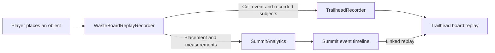

# Waste Management

SludgeTower is a Unity card game and tower defense simulation. Players place
defenses and manage resources between waves. Issues move along waypoint paths
toward the end of the board.

[Open the interactive waypoint explainer](interactive/waypoint-path-explainer.html)
to see how a path guides moving objects. Use
[Verify analytics and replay](verify.md) to trace the same board activity
through Summit and Trailhead.

## How one placement becomes two records

`WasteBoardReplayRecorder` subscribes to board, phase, level, and issue events.
The recorder gives Trailhead the board dimensions and transform so the viewer
can reconstruct cell positions. It sends object activity to Summit as named
events with properties and measurements. Trailhead records movement for tracked
subjects, such as the player camera and moving issues.

## Source map

| Area | Source |
| --- | --- |
| Turn and wave progression | [`Core/TurnController.cs`](https://github.com/Unity-Environmental-University/WasteManagement/blob/main/Core/TurnController.cs) |
| Board events and metadata | [`Core/WasteBoardReplayRecorder.cs`](https://github.com/Unity-Environmental-University/WasteManagement/blob/main/Core/WasteBoardReplayRecorder.cs) |
| Incremental replay upload | [`Core/TrailheadRecorder.cs`](https://github.com/Unity-Environmental-University/WasteManagement/blob/main/Core/TrailheadRecorder.cs) |
| Analytics queue | [`Core/SummitAnalytics.cs`](https://github.com/Unity-Environmental-University/WasteManagement/blob/main/Core/SummitAnalytics.cs) |
